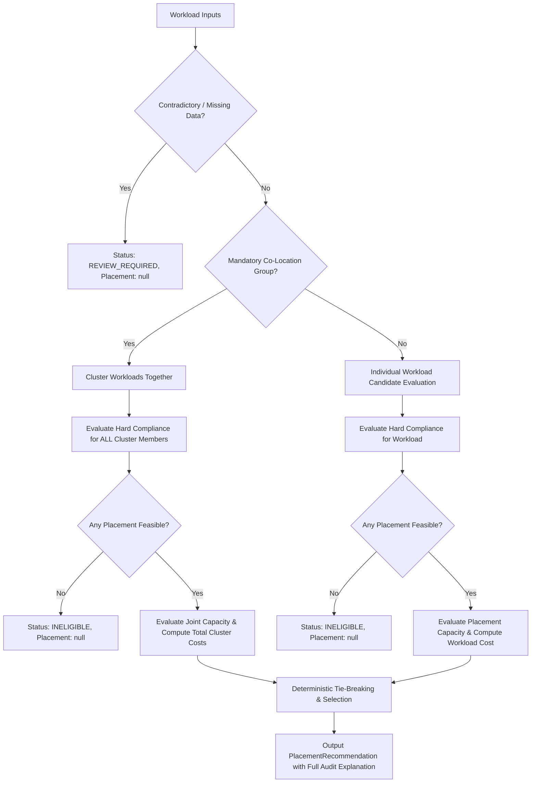

# Sky Cash Placement Decision Algorithm

This document details the deterministic placement decision engine implemented in [`backend/app/engine/`](file:///D:/skycash/backend/app/engine/).

---

## 1. Engine Architecture & Non-Negotiables

The Sky Cash decision engine provides defensible recommendations for hosting workloads across an on-premises Karnataka Private Data Centre (`karnataka-dc-1`) and approved public cloud regions (`aws-ap-south-1`, `azure-central-india`).

### Fundamental Rules:
1. **Compliance Precedence**: Hard compliance rules (data residency and sensitivity) are evaluated strictly before any cost comparison. Lower cloud pricing can **never** override a residency or sensitivity mandate.
2. **Co-Location Inviolability**: Mandatory co-located workloads are evaluated as unified clusters. If a cluster cannot fit in any common placement, the engine reports **INFEASIBLE** rather than silently separating workloads.
3. **No False Confidence**: Missing, invalid, or mutually contradictory inputs return a status of `REVIEW_REQUIRED` rather than an ungrounded recommendation.
4. **Deterministic Reproducibility**: Given identical inputs, the engine produces identical recommendations without stochastic drift.
5. **Explainability**: Every recommendation includes binding constraints, factors, assumptions, and an explicit log of why each rejected alternative was excluded.
6. **Infeasibility Safeguard**: Workloads or groups that cannot be placed feasibly are assigned `status: INELIGIBLE`, `recommended_placement: null`, and `hard_compliance_passed: false`. They cannot be marked as successful placements.

---

## 2. Decision Pipeline Flow

---

## 3. Cost Calculation Formulas

All cost models are calculated on a **monthly billing interval** (720-hour basis) in **INR**.

### 3.1 Private Data Centre Monthly Cost
For Karnataka Private Data Centre (`karnataka-dc-1`):
$$\text{Raw Compute} = \text{allocated\_cpu\_cores} \times \text{amortized\_cost\_per\_cpu\_core\_month}$$
$$\text{Raw RAM} = \text{allocated\_ram\_gib} \times \text{amortized\_cost\_per\_ram\_gib\_month}$$
$$\text{Raw Storage} = \text{allocated\_storage\_gib} \times \text{amortized\_cost\_per\_storage\_gib\_month}$$
$$\text{Subtotal} = \text{Raw Compute} + \text{Raw RAM} + \text{Raw Storage}$$
$$\text{PUE Multiplier} = 1.0 + \frac{\text{power\_cooling\_pue\_overhead\_pct}}{100}$$
$$\text{Total Monthly DC Cost} = \text{Subtotal} \times \text{PUE Multiplier}$$

*Note:* Fixed facility overhead is tracked separately at estate level to prevent artificial per-workload skew.

### 3.2 Public Cloud Monthly Cost
For an approved Public Cloud Region:
$$\text{Compute} = \text{allocated\_cpu\_cores} \times \text{compute\_rate\_per\_vcpu\_month}$$
$$\text{Memory} = \text{allocated\_ram\_gib} \times \text{memory\_rate\_per\_gib\_month}$$
$$\text{Storage} = \text{allocated\_storage\_gib} \times \text{storage\_ssd\_rate\_per\_gib\_month}$$
$$\text{Egress} = \text{monthly\_egress\_gib} \times \text{egress\_rate\_per\_gib}$$
$$\text{Total Monthly Cloud Cost} = \text{Compute} + \text{Memory} + \text{Storage} + \text{Egress}$$

---

## 4. Hard Compliance Rules (Eligibility Gates)

A candidate placement must pass all 4 checks to be considered feasible:

1. **Administrative Approval**:
   - Cloud region must have `approval_status` of `APPROVED` or `PROVISIONAL`.
   - Regions with `RESTRICTED` or `UNAPPROVED` are rejected.
2. **Data Residency Mandate**:
   - `KARNATAKA_DC_ONLY`: Only `location_state == "Karnataka"` (Private DC) is permitted.
   - `INDIA_ONLY`: Candidate placement must have sovereign jurisdiction `location_country == "IN"`. Foreign regions (e.g. `aws-us-east-1`) are rejected outright.
   - `ANY_APPROVED_REGION`: Permitted in any approved environment.
3. **Data Sensitivity Ceiling**:
   - Workload's `data_sensitivity` must be in the placement's `allowed_sensitivities`.
   - `RESTRICTED` workloads are strictly prohibited from public cloud.
4. **Mandatory Compliance Certifications**:
   - Every entry in `workload.required_certifications` must be held by the candidate placement.

---

## 5. Capacity Constraints

- **Private DC Usable Headroom**:
  - `usable_cpu_cores` (reserves hypervisor capacity).
  - `usable_ram_gib` (reserves hypervisor memory).
  - `usable_storage_gib` (reserves RAID/parity overhead).
- If $\text{requested} + \text{existing} > \text{usable}$, the Private DC candidate is rejected with an explicit capacity breach reason.
- Public cloud capacity is assumed elastic up to account quota limits.

---

## 6. Co-Location & Dependency Modeling

1. Workloads linked by `CO_LOCATE` with `is_mandatory=True` form an atomic cluster using union-find connected components.
2. The candidate placements for the cluster are the **intersection** of compliant placements for all member workloads.
3. Total cluster resource demands (CPU, RAM, storage) must fit within the placement's capacity.
4. If no common placement satisfies compliance and capacity for all members, the entire cluster is declared `INELIGIBLE` (`recommended_placement: null`). The group is never silently split.

---

## 7. Deterministic Tie-Breaking Order

When multiple candidate placements are feasible and deliver identical monthly costs, the engine breaks ties deterministically:
1. **Prefer Current Placement**: If an equal-cost candidate is already the workload's current placement, select it to avoid operational churn, network migration risk, and cutover downtime.
2. **Prefer Private DC**: If neither is current, select Private DC over public cloud (preserves data sovereignty and internal asset utilization).
3. **Alphabetical Placement ID**: If two cloud regions have identical cost, select the lower lexicographical `region_id` (e.g. `aws-ap-south-1` before `azure-central-india`).

---

## 8. Limitations and Heuristic vs. Global Optimal

- **MVP Heuristic Nature**: The MVP engine uses a greedy, constraint-first evaluation with cluster grouping. It evaluates co-location groups and individual workloads sequentially against remaining capacity.
- **Important Limitation Notice**: While it guarantees **feasibility** and **local cost optimality**, it does **not** claim global mathematical optimality (e.g. solving an NP-hard multidimensional bin-packing problem via Mixed-Integer Linear Programming). For example, it does not dynamically rearrange already-placed workloads to make room for an incoming larger workload.
- **Future Enhancement**: If private DC capacity reaches >90% saturation with competing non-colocated workloads, a global branch-and-bound solver could be added without breaking the recommendation interface.

---

## 9. Strategy Mode Flow: Cloud-Only vs. Hybrid Placement

The engine exposes a dual-strategy evaluation workflow in [`backend/app/engine/placement_modes.py`](file:///D:/skycash/backend/app/engine/placement_modes.py):

### 9.1 Mode A: Hired Servers Only (Cloud-Only)
- Evaluates placing 100% of estate workloads into approved public cloud regions (`PublicCloudRegion`).
- Evaluates mandatory co-location clusters jointly to ensure cluster members share the exact same cloud region.
- Detects **Private DC Underutilisation**: Reports that on-premise hardware (cores, RAM, storage) remains 0.0% utilised, leaving amortized infrastructure idle while paying 100% operational cloud expenses.
- **Compliance Enforcement**: If any workload requires `KARNATAKA_DC_ONLY` or has `RESTRICTED` sensitivity, the scenario is declared **INFEASIBLE** with explicit compliance violation reasons. It will never be recommended.

### 9.2 Mode B: Local + Hired Servers (Hybrid)
- Evaluates and compares two candidate alternatives:
  1. **Local-Only Placement**: Places 100% of workloads on-premise. Detects **Capacity Overload** if combined resource demands exceed usable Private DC limits (reporting exact CPU, RAM, or storage deficits).
  2. **Hybrid Placement**: Distributes workloads between the Private DC and public cloud, keeping regulated workloads local and bursting unconstrained workloads to cloud.
- Recommends the **lowest-cost feasible option** between the evaluated candidates.
- If all candidates are infeasible (e.g. an oversized local-only workload exceeds DC capacity and cannot run on cloud), the engine returns `recommended_scenario = None` and documents why each option failed.

---

## 10. Verification & Test Coverage Matrix

The decision engine is verified across [`backend/tests/test_engine.py`](file:///D:/skycash/backend/tests/test_engine.py) and [`backend/tests/test_placement_modes.py`](file:///D:/skycash/backend/tests/test_placement_modes.py):

| Verification Case | Test Function | Verified Behavior |
| :--- | :--- | :--- |
| **Case A: Cheapest Eligible Placement** | `test_cheapest_eligible_placement_chosen_when_both_valid` | When DC and Cloud are both valid, selects lower-cost option. |
| **Case B: Residency Restriction** | `test_cheaper_placement_violating_residency_is_rejected` | Rejects cheaper US region (`aws-us-east-1`) for Indian sovereign workload. |
| **Case B (cont.): State Residency** | `test_workload_restricted_to_karnataka_dc_rejects_all_cloud_regions` | Rejects all cloud regions for `KARNATAKA_DC_ONLY` workload. |
| **Case C: Capacity Limit** | `test_dc_capacity_limit_makes_placement_infeasible_for_dc` | Rejects DC when usable CPU headroom is exceeded; falls back to cloud. |
| **Case D: Dependency Co-Location** | `test_dependent_workloads_remain_co_located` | Keeps API and DB together in Karnataka DC. |
| **Case D (cont.): Infeasible Co-Location** | `test_co_location_group_infeasible_reported_instead_of_silently_split` | Reports `INELIGIBLE` for group when combined demand exceeds DC capacity. |
| **Case E: Missing/Conflicting Data** | `test_workload_with_conflicting_information_triggers_review_required` | Returns `REVIEW_REQUIRED` for contradictory provider/residency rules. |
| **Case E (cont.): Missing Placement** | `test_workload_with_missing_current_placement_triggers_review_required` | Returns `REVIEW_REQUIRED` when `current_placement` is missing/UNKNOWN. |
| **Case F: Equal Costs Tie-Breaking** | `test_tie_between_eligible_placements_uses_deterministic_tie_breaking` | Tests current placement preference and alphabetical fallback. |
| **Case G: No Feasible Placement** | `test_no_feasible_placement_exists` | Reports `INELIGIBLE`, `recommended_placement: null`, and rejection log. |
| **Strategy: Cloud-Only Rejection** | `test_cloud_only_compliance_rejection` | Detects compliance failure & DC underutilisation when local-mandated workloads exist. |
| **Strategy: Cloud-Only Feasible** | `test_cloud_only_all_eligible` | Recommends cloud-only when all workloads meet cloud compliance rules. |
| **Strategy: Local Capacity Overload** | `test_local_only_capacity_overload` | Flags capacity overload when local workloads exceed DC headroom. |
| **Strategy: Hybrid Optimization** | `test_hybrid_selects_lowest_cost_feasible` | Recommends lowest-cost feasible compliant mix between local and cloud. |
| **Strategy: All Infeasible** | `test_all_infeasible_scenario` | Explains rejection reasons when no candidate scenario can be placed feasibly. |
| **Strategy: Co-Location in Cloud** | `test_cloud_only_mandatory_co_location` | Enforces shared cloud region placement for mandatory co-location clusters. |
| **Strategy: Synthetic Dataset Flow** | `test_synthetic_dataset_placement_flow` | Verifies end-to-end flow on enterprise synthetic dataset. |
